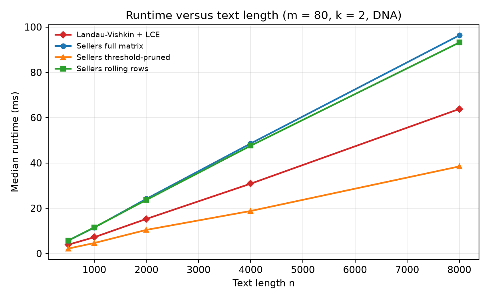
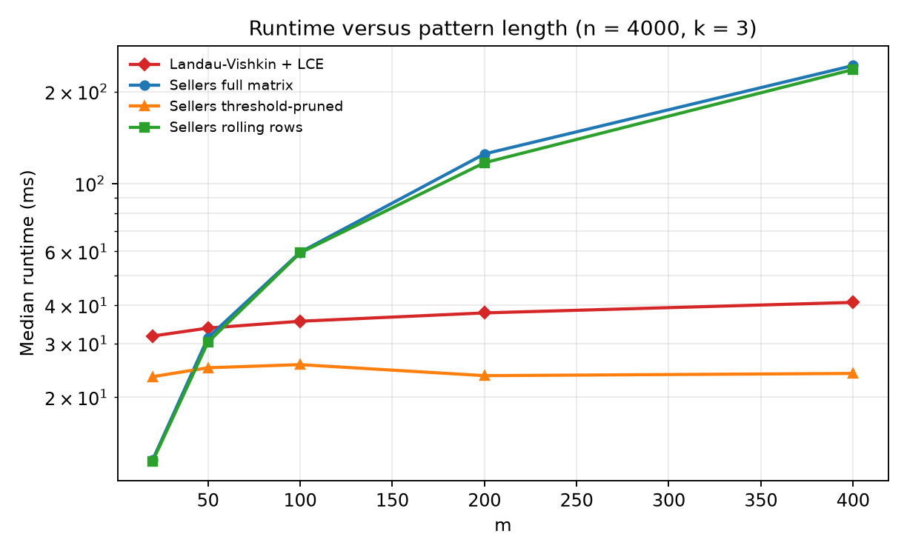
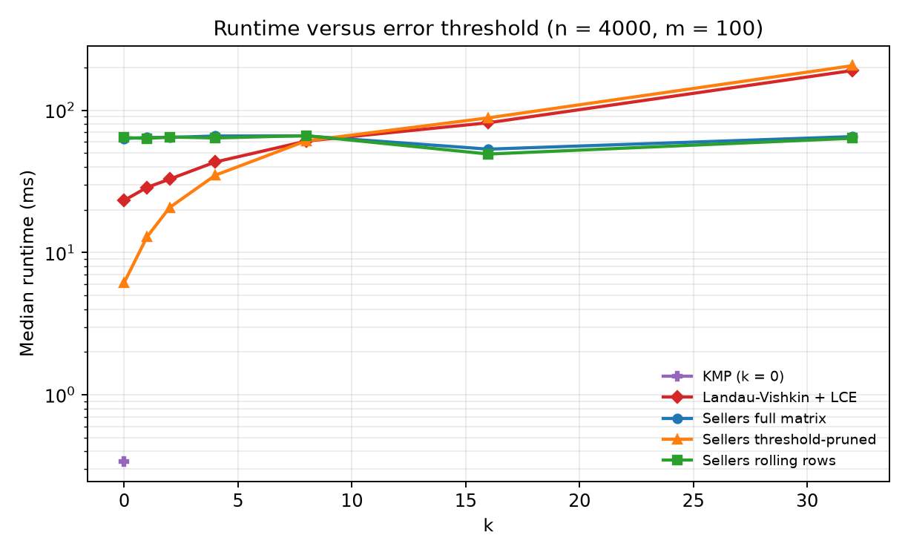
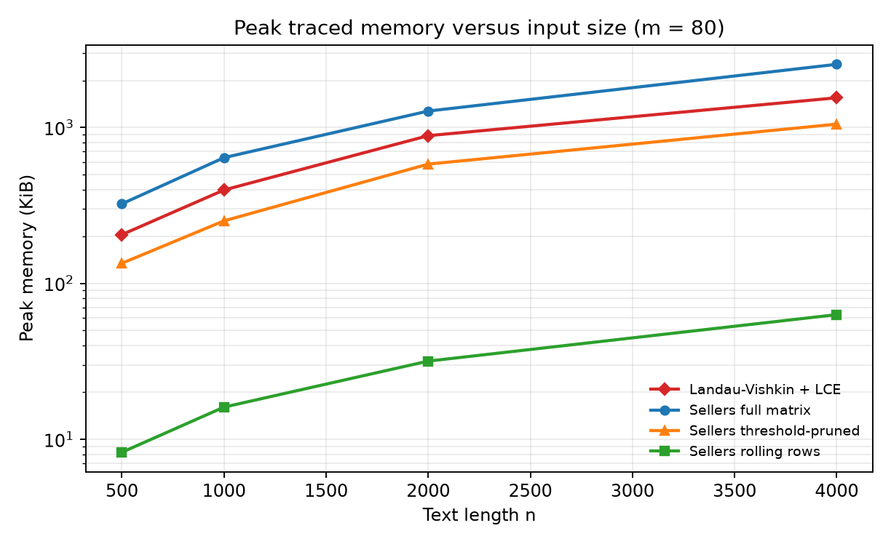
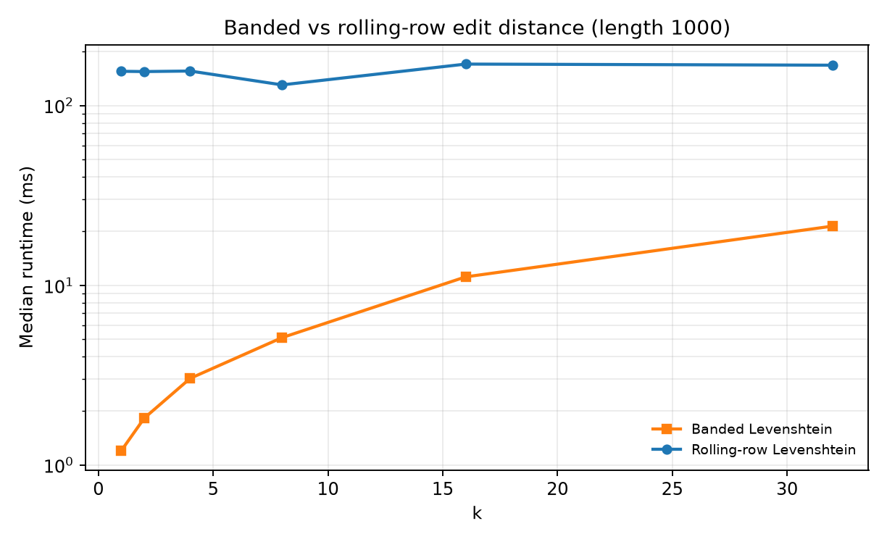
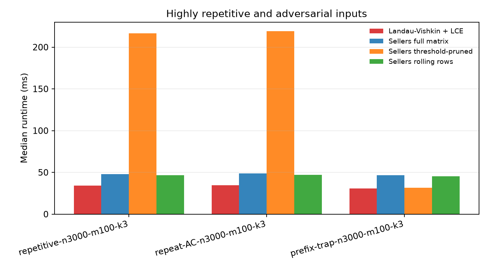

# Approximate String Matching

### Design, Analysis, and Experimental Comparison of Algorithms

**[Your name]** · DAA Project · November 2026

---

## Problem

Given text `T` (length `n`), pattern `P` (length `m`), threshold `k`:

- Edit operations: insertion, deletion, substitution
- Each operation costs 1
- Report every end position `j` such that some `T[s:j]` matches `P` with distance `<= k`

```text
Text:    A B C X D E F G
Pattern: A B C D E F

k = 0: no match
k = 1: end 7, distance 1
```

---

## What makes the problem interesting

Three different resources can be optimised:

1. **Time** — scan fewer DP cells or fewer diagonals
2. **Memory** — store one row, one band, or active cells only
3. **Error budget** — exploit a small `k` or a long pattern

The answer is not a single winning algorithm.
It depends on `k/m`, pattern length, memory, alphabet, and repetitive structure.

---

## Implemented methods

| Method | Purpose |
|---|---|
| Naive + KMP | exact baseline, `k = 0` |
| Levenshtein full / rolling | string-to-string distance |
| Banded Levenshtein | fast distance when true distance is small |
| Sellers full / rolling | semi-global approximate search |
| Threshold-pruned Sellers | safe active-cell pruning |
| Landau–Vishkin + LCE | diagonal-band search |
| Hamming | restricted substitutions-only case |

All implementations are written from scratch.
No heuristic pruning is used.

---

## Sellers' semi-global recurrence

```text
D[0][j] = 0   for every j     # free start anywhere
D[i][0] = i                   # delete a pattern prefix
D[i][j] = min(
    D[i-1][j] + 1,                     # deletion
    D[i][j-1] + 1,                     # insertion
    D[i-1][j-1] + (P[i-1] != T[j-1])   # match/substitution
)
```

Report end `j` whenever `D[m][j] <= k`.

- `D[0][j] = 0` is what turns global alignment into substring search.
- `k = 0` produces exactly the KMP matches.

---

## Banding: safe only where it is proved

For global distance `<= k`:

```text
|i - j| <= k
```

Only this band can contain an optimal path. Time `O(k · min(m,n))`, space `O(k)`.

**But this band is unsafe for semi-global search:**

```text
T = XXXXXABC
P = ABC
k = 0
```

The match starts far from the main diagonal.
That is why banding is used here for **distance**, while search uses safe alternatives: threshold pruning and Landau–Vishkin.

---

## Landau–Vishkin: jump over exact runs

State: farthest reach on diagonal `h = column - row` with `e` edits.

```text
row = max(
    F[e-1][h] + 1,     # substitution
    F[e-1][h-1],       # insertion
    F[e-1][h+1] + 1    # deletion
)
row += LCE(P[row:], T[row+h:])
```

- Only `O(nk)` frontier states
- One LCE query jumps over an arbitrarily long exact run
- Semi-global version initialises a zero-error path at every text start
- Reports stopping points so **every** end position is returned

---

## Correctness

Four layers of checking:

1. Known examples
2. Exhaustive binary inputs: `n < 6`, `m < 4`, `k < 4`
3. Randomized binary / DNA / English-like cases
4. Structural checks: valid end, valid distance, no duplicates

**Result:** 120 tests pass; every implementation matches brute force exactly.

These are exact optimisation algorithms, so precision and recall are 1.0 relative to the Levenshtein definition.

---

## Experimental setup

- Generated inputs in memory; file reading excluded
- Interleaved, batched timing rounds
- Per-call medians; lower envelope of three independent suites
- Peak memory via `tracemalloc`
- AMD Ryzen 7 7840HS · Windows 11 · Python 3.14

Workloads: planted mutations, binary/DNA/English alphabets, repetitive text, prefix traps, banded distance.

---

## Results: text and pattern length



- Every method grows linearly in `n` for fixed `m`
- Sellers full and rolling overlap in time
- Pruned is fastest on this random DNA workload

---

## Results: pattern length



- Sellers DP is linear in `m`
- Pruned is almost flat for larger `m`
- Landau–Vishkin is nearly independent of `m` for fixed `n`, `k`
- Crossover: plain DP wins for very small patterns

---

## Results: error threshold and memory

 

- Sellers DP is flat in `k`
- Pruning and Landau–Vishkin win for small `k`, degrade for large `k`
- Rolling rows: ~40× lower memory than the full matrix

---

## Results: banded distance and adversarial inputs

 

- Banded distance: 7–129× faster for small true distance
- Repetitive text defeats threshold pruning
- Landau–Vishkin handles repetitive text well by jumping over exact runs

---

## Conclusions

- Rolling rows: **space** improvement only
- Threshold pruning: **practical** improvement, input-dependent, same worst case
- Banded distance: real **time** improvement for global distance with small `k`
- Landau–Vishkin: the most robust method for long patterns and repetitive text
- KMP remains the right tool at `k = 0`

**Choose the algorithm from the regime, not from a single benchmark table.**

---

## Demo and reproduction

```powershell
python -m asm.cli demo
python -m asm.cli validate --cases 200
python -m pytest -q
python scripts/run_experiments.py
```

Repository contents:

- full report: `docs/REPORT.md`
- implementations: `asm/algorithms.py`
- tests: `tests/test_algorithms.py`
- results and figures: `results/`

Thank you.
