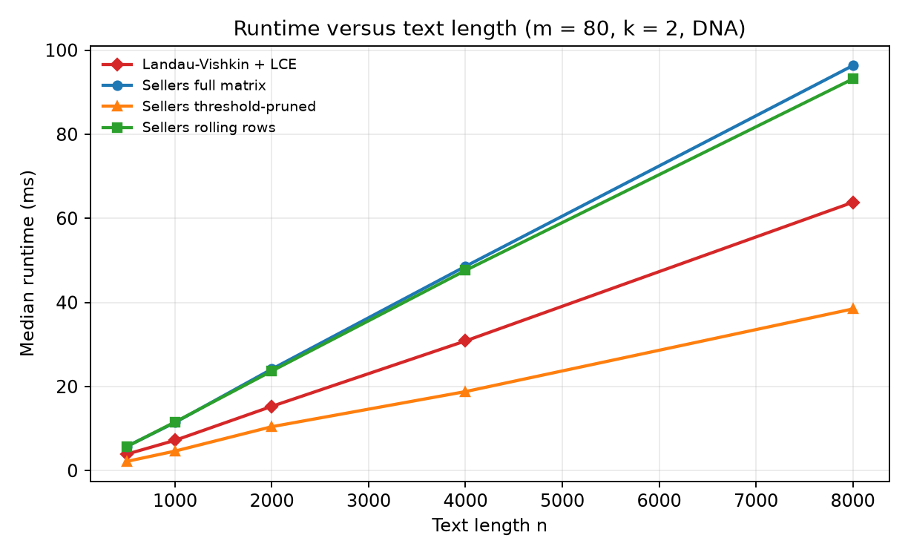
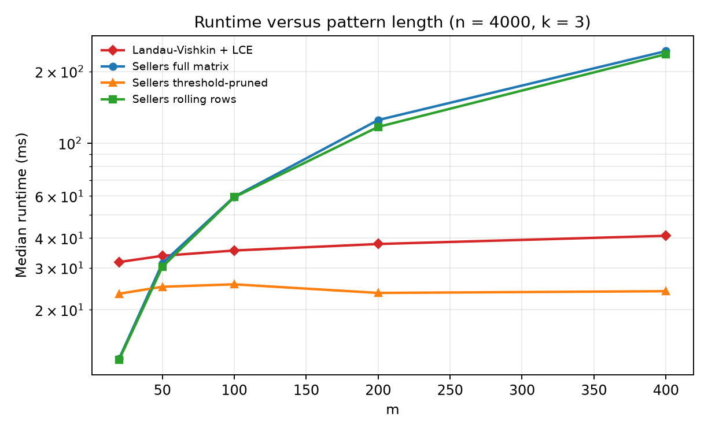
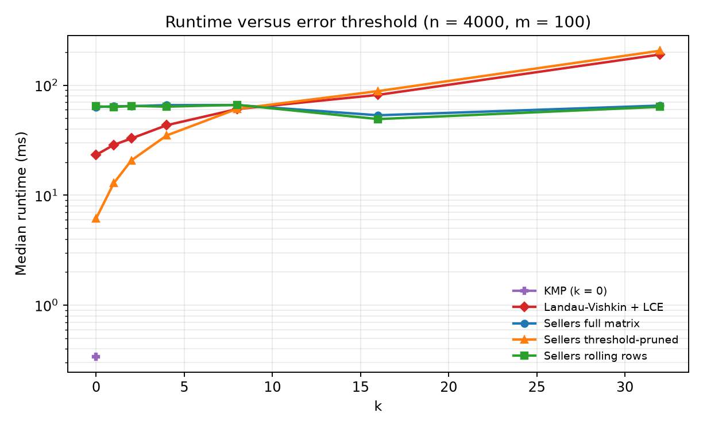
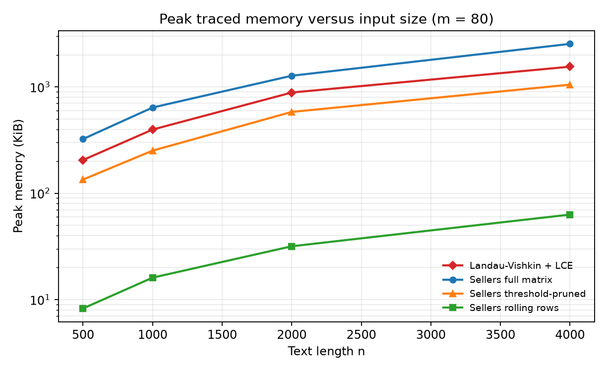
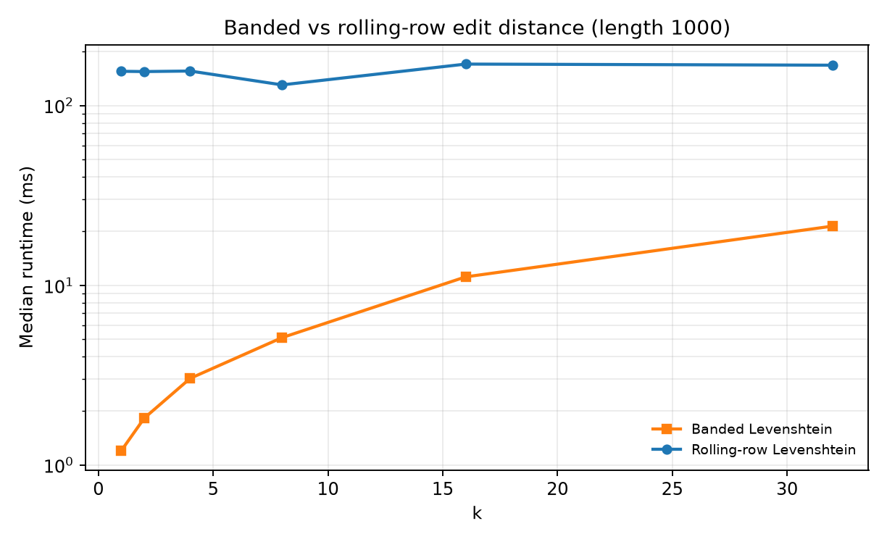
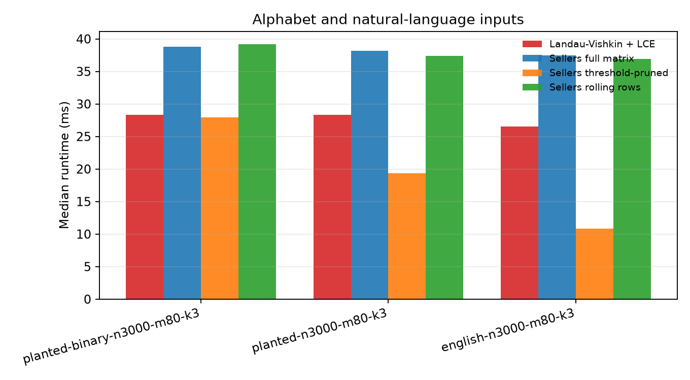
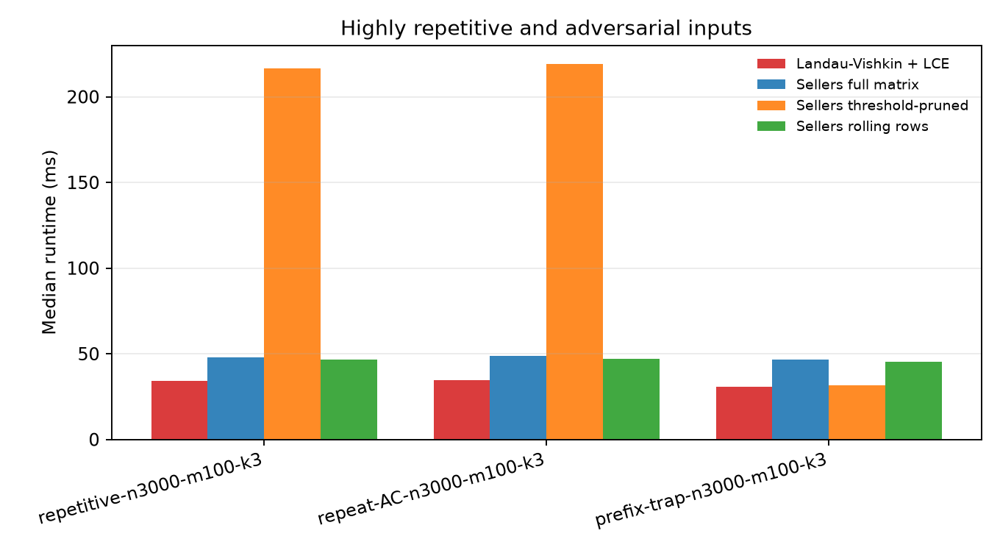

# Design, Analysis, and Experimental Comparison of Algorithms for Approximate String Matching

**Course project report — Design and Analysis of Algorithms**

**Author:** _[add your name]_  
**Institution:** _[add your institution]_  
**Date:** 9 November 2026

---

## Abstract

Approximate string matching locates a pattern in a text when the match may contain a bounded number of insertions, deletions, and substitutions. This project implements and compares exact algorithms for two related tasks: computing Levenshtein distance between two strings, and finding every text position at which a substring matches a pattern with distance at most `k`. The implementations are written from scratch in Python: full and rolling-row Levenshtein distance, Knuth–Morris–Pratt exact matching, Sellers' semi-global dynamic program, a correctness-preserving threshold-pruned Sellers search, banded edit distance, and a Landau–Vishkin diagonal-band search with deterministic longest-common-extension queries. All approximate matchers are exact optimisation algorithms, not heuristics: on exhaustive small inputs and randomized tests they return precisely the same ending positions and minimum distances as a brute-force reference.

Experiments vary text length, pattern length, error threshold, alphabet, and input structure. The main findings are: rolling rows reduce memory from `Θ(nm)` to `Θ(m)` without changing running time; threshold pruning is very effective when few cells can still reach the threshold, but degenerates on highly repetitive inputs; banded edit distance is dramatically faster than full dynamic programming when the true distance is small; and diagonal-band search with longest-common-extension jumps is the most robust method for long patterns and repetitive text. No single algorithm wins everywhere. A fixed diagonal band around the main diagonal is **not** correct for semi-global search, a subtle point that this report makes explicit and handles with safe alternatives.

---

## 1. Problem definition

Let

- text `T = T[0..n-1]`, with `n = |T|`;
- pattern `P = P[0..m-1]`, with `m = |P|`;
- maximum permitted edit distance `k`.

The edit operations are insertion, deletion, and substitution, each with unit cost. The **Levenshtein distance** `ed(P, Q)` is the minimum number of operations that transforms `P` into `Q`.

Two tasks are studied.

1. **String-to-string distance.** Compute `ed(P, Q)` for two strings.
2. **Approximate substring search (semi-global matching).** For every end position `j`, compute
   `d[j] = min { ed(P, T[s..j-1]) : 0 <= s < j }`,
   and report `j` with `d[j] <= k`.

The implementation reports a match as `(end, distance)`, where `end` is a 0-based **exclusive** end position. The matched substring is some `T[s:end]`; add one to `end` for a 1-based human-readable ending position. Starts are not unique and are therefore not part of the basic interface.

Special conventions:

- A non-empty pattern is never matched to the empty substring.
- The empty pattern matches at every end position `0..n` with distance zero.
- Every reported match carries its minimum distance, not merely a yes/no flag.

Example:

```text
Text:    A B C X D E F G
Pattern: A B C D E F
k = 0:   no match
k = 1:   end 7, distance 1   (delete X from the text-side match)
```

The project also discusses Hamming distance as the restricted case in which only substitutions are allowed and both strings must have equal length.

---

## 2. Algorithms

### 2.1 Naive exact search and KMP (`k = 0`)

The naive exact matcher compares the pattern with every text window in `O(nm)` time. Knuth–Morris–Pratt precomputes the longest proper prefix that is also a suffix (LPS) array and searches in `O(n + m)` time with `O(m)` space. KMP is the baseline for `k = 0` and is also used to confirm that every approximate matcher reduces to exact matching when `k = 0`.

### 2.2 Full-matrix Levenshtein distance

Define

```text
D[i][j] = ed(P[0..i-1], Q[0..j-1]).
```

Initialisation and recurrence:

```text
D[i][0] = i
D[0][j] = j

D[i][j] = min(
    D[i-1][j] + 1,                    # delete P[i-1]
    D[i][j-1] + 1,                    # insert Q[j-1]
    D[i-1][j-1] + (P[i-1] != Q[j-1])  # match or substitute
)
```

The answer is `D[m][n]`. Time and space are both `Θ(mn)`.

**Correctness.** Every alignment of the two prefixes ends with one of three possibilities: the last pattern character is deleted, the last text character is inserted, or the two last characters are aligned. The recurrence takes the cheapest of these, so induction on `i+j` proves optimality (optimal substructure).

### 2.3 Rolling-row Levenshtein distance

Only the previous row is needed. The recurrence becomes `O(mn)` time and `O(min(m,n))` space after swapping the strings so that the shorter one supplies the rows.

### 2.4 Sellers' semi-global dynamic program

Sellers' algorithm changes the boundary conditions of the same matrix:

```text
D[0][j] = 0   for all j    # a match may begin anywhere
D[i][0] = i                # delete a pattern prefix
D[i][j] = min(
    D[i-1][j] + 1,
    D[i][j-1] + 1,
    D[i-1][j-1] + (P[i-1] != T[j-1])
)
```

A qualifying match ends at `j` exactly when `D[m][j] <= k`. The full matrix uses `O(nm)` space; rolling rows use `O(m)` additional space, though the previous column of the current row is still part of the recurrence.

**Why `D[0][j] = 0` works.** `D[0][j]` is the distance from the empty pattern to any suffix of `T[0..j-1]`. The empty pattern matches the empty suffix for free, so every text position is a legal start. `D[m][j]` therefore takes the minimum over all starts.

**Why `k = 0` agrees with exact matching.** With unit costs, a distance of zero means no edit is used, so every aligned pair matches exactly. Thus `D[m][j] = 0` iff the pattern occurs as a suffix of `T[0..j-1]`, which is precisely the output of KMP.

### 2.5 Threshold-pruned Sellers search

Edit costs are non-negative. If a cell satisfies `D[i][j] > k`, no continuation through that cell can return to a value `<= k`. The pruned implementation stores only active cells (`D <= k`) and computes a candidate column only when one of its three predecessors is active. It is safe: it never removes a cell that can lie on a qualifying path. Its worst case is still `Θ(nm)` because a repetitive input such as `AAAA...` activates almost every cell, but it often avoids most of the matrix on random or natural-language data.

### 2.6 Banded edit distance

For **string-to-string** distance, if `ed(P,Q) <= k`, every alignment in the band uses at most `k` insertions/deletions, so it cannot move more than `k` diagonals away from the main diagonal:

```text
|i - j| <= k.
```

Only this band is evaluated. Rows are stored as two strips of width at most `2k + 1`, giving `O(k · min(m,n))` time and `O(k)` space. If the length difference exceeds `k`, the function immediately returns `k+1` (meaning "greater than `k`").

### 2.7 Landau–Vishkin diagonal-band search

Landau–Vishkin replaces cell-by-cell evaluation on each diagonal by one **farthest-reaching state per (error level, diagonal)**. Let

```text
h = column - row.
```

A state stores the largest row reachable with at most `e` edits on diagonal `h`, after greedily extending through every following exact character match. A longest-common-extension (LCE) query jumps over an exact run in `O(1)` after preprocessing.

The transition from layer `e-1` to layer `e` is:

```text
row = max(
    F[e-1][h] + 1,     # substitution
    F[e-1][h-1],       # insertion (consume a text character)
    F[e-1][h+1] + 1    # deletion (consume a pattern character)
)
row = row + LCE(P[row:], T[row+h:])
```

For semi-global matching, a zero-error state is initialised at every text start. For every state, the implementation also reports valid stopping points where the remaining pattern suffix is deleted; this is necessary because the project reports **every** end position, not only the farthest one. The core frontier performs `O(nk)` LCE queries. The Python implementation's endpoint enumeration adds an `O(k)` factor in the worst case. LCE preprocessing uses a suffix array, Kasai LCP, and a sparse table; the implemented suffix-array construction is `O((n+m) log²(n+m))` and the sparse table uses `O((n+m) log(n+m))` space. A production implementation would use a suffix tree or a linear-space RMQ for `O(n+m)` preprocessing.

### 2.8 Why a fixed band is unsafe for semi-global search

A common but incorrect shortcut is to apply the global `|i-j| <= k` band directly to Sellers' matrix. It fails because a match may start far to the right. Example:

```text
T = XXXXXABC
P = ABC
k = 0
```

The only occurrence ends at position 8, far outside `|i-j| <= 0`. The global band would miss it. For semi-global search, the relevant diagonals are determined by every possible start, not only by the origin. This project therefore uses two safe parameter-sensitive alternatives: threshold pruning and Landau–Vishkin diagonal states. The banded `O(k)` algorithm is used only for the string-to-string distance task, where its correctness argument is valid.

### 2.9 Hamming distance

Hamming distance permits only substitutions and requires equal lengths:

```text
H(P,Q) = number of positions where P[i] != Q[i].
```

It is included as the restricted special case; it is not used as an approximation to Levenshtein distance.

---

## 3. Complexity summary

| Algorithm | Task | Time | Space | Notes |
|---|---|---:|---:|---|
| Naive exact | exact search, `k=0` | `O(nm)` | `O(1)` | pedagogical baseline |
| KMP | exact search, `k=0` | `O(n+m)` | `O(m)` | LPS preprocessing |
| Levenshtein full | distance | `O(mn)` | `O(mn)` | traceback-friendly |
| Levenshtein rolling | distance | `O(mn)` | `O(min(m,n))` | same recurrence |
| Sellers full | approximate search | `O(nm)` | `O(nm)` | all DP cells |
| Sellers rolling | approximate search | `O(nm)` | `O(m)` | baseline in experiments |
| Sellers threshold-pruned | approximate search | `O(nm)` worst case | `O(active)` | safe pruning |
| Banded Levenshtein | distance `<= k` | `O(k · min(m,n))` | `O(k)` | global alignment only |
| Landau–Vishkin core | approximate search | `O(nk)` LCE queries | `O(n + LCE)` | plus preprocessing |
| Landau–Vishkin, this implementation | approximate search | `O(nk²)` worst-case reporting | `O(n + (n+m) log(n+m))` | deterministic LCE |
| Hamming | equal-length mismatches | `O(n)` | `O(1)` | substitutions only |

The classic full-matrix and rolling-row algorithms have the same asymptotic time. The difference is memory, not time, and the experiments confirm this: their curves overlap.

---

## 4. Correctness methodology

The project uses six independent layers of validation.

1. **Known examples.** Distances such as `kitten -> sitting = 3` and `flaw -> lawn = 2`; exact, empty, and no-match cases.
2. **Exhaustive small inputs.** Every binary string with `n < 6`, every pattern with `m < 4`, and every `k in {0,1,2,3}`. All four search implementations are compared with brute force.
3. **Randomized testing.** Hundreds of random cases over binary, DNA, English-like, and Unicode inputs, including empty strings, pattern longer than text, and `k` larger than the pattern.
4. **Structural checks.** Ends are sorted, inside the text, distances are within `[0,k]`, duplicates are removed, and minimum distances are correct.
5. **Generator checks.** Seeds are deterministic; generated text/pattern lengths are exact; planted spans are disjoint; planted witnesses satisfy the requested distance bound.
6. **CLI and pipeline checks.** All algorithms run through the CLI, invalid arguments fail cleanly, and the benchmark/combine/analysis pipeline can run end to end.

The test suite contains 120 tests and passes. Because all algorithms are exact dynamic programs or exact diagonal-state algorithms, their precision and recall relative to the chosen distance definition are `1.0`; there are no false positives or false negatives. The pruned implementation is a safe pruning, not a heuristic. No approximate/heuristic pruning was used.

Representative property checks:

```text
for every small text, pattern, k:
    result(Sellers)       == result(brute force)
    result(pruned)        == result(brute force)
    result(LandauVishkin) == result(brute force)
    result(KMP)           == result(Sellers, k=0)
```

---

## 5. Experimental setup

The benchmark runner generates all inputs in memory and excludes file reading from timing. For each case, algorithms are timed in interleaved rounds to reduce thermal and scheduling bias. A sample repeats the call enough times to reach roughly 30 ms of work; the reported value is the per-call median. Three independent suites were run and the per-case lower envelope is used in the final tables. Peak memory is measured separately with `tracemalloc`.

Machine:

- AMD Ryzen 7 7840HS, 8 cores / 16 threads, 3.8 GHz nominal
- Windows 11, Python 3.14.4
- No GPU or external string library is used by the core algorithms; pandas/matplotlib are used only for analysis and plots.

Workload families:

- random planted mutations over binary, DNA, and English-like alphabets;
- exact matches, insertions, deletions, substitutions, and mixed edits;
- highly repetitive unary and binary text;
- a prefix-trap input designed to create many candidate alignments;
- banded edit distance on a 1000-character DNA string and a mutated copy.

All materials are reproducible from the repository; see Section 9.

---

## 6. Results

### 6.1 Runtime versus text length

Fixed `m = 80`, `k = 2`, DNA, planted mutations.



| `n` | Sellers full | Sellers rolling | Pruned | Landau–Vishkin |
|---:|---:|---:|---:|---:|
| 500 | 5.72 ms | 5.67 ms | 2.17 ms | 3.88 ms |
| 1000 | 11.42 | 11.54 | 4.62 | 7.18 |
| 2000 | 24.14 | 23.67 | 10.43 | 15.27 |
| 4000 | 48.57 | 47.60 | 18.78 | 30.83 |
| 8000 | 96.32 | 93.14 | 38.44 | 63.80 |

All methods grow approximately linearly in `n` for fixed `m`, as expected because the number of DP cells is `nm = O(n)` when `m` is fixed. Sellers full and rolling are indistinguishable in time. The pruned matcher is the fastest here; Landau–Vishkin pays suffix-array preprocessing and is second. The lower envelope across repeated runs gives a clean near-2× increase for each doubling of `n`.

### 6.2 Runtime versus pattern length

Fixed `n = 4000`, `k = 3`, DNA.



| `m` | Sellers full | Sellers rolling | Pruned | Landau–Vishkin |
|---:|---:|---:|---:|---:|
| 20 | 12.47 ms | 12.34 ms | 23.33 ms | 31.69 ms |
| 50 | 31.31 | 30.26 | 24.95 | 33.66 |
| 100 | 59.61 | 59.32 | 25.55 | 35.43 |
| 200 | 125.11 | 117.08 | 23.51 | 37.73 |
| 400 | 243.66 | 236.47 | 23.91 | 40.85 |

This is the clearest algorithmic separation. Full and rolling Sellers grow linearly in `m` (about 19.5× for a 20× pattern). Threshold pruning becomes faster as `m` grows because long patterns make most cells unable to return below `k`; its time is nearly flat in this range. Landau–Vishkin is almost flat too: its work depends on `n` and `k`, not directly on `m`, and the suffix-array size changes only modestly.

For small patterns (`m = 20`), the pruned and Landau–Vishkin implementations are slower than plain DP. The dictionary/active-cell bookkeeping and suffix-array preprocessing dominate when the matrix is already small. This is a practical crossover, not an asymptotic contradiction.

### 6.3 Runtime versus error threshold

Fixed `n = 4000`, `m = 100`, DNA.



| `k` | Sellers rolling | Pruned | Landau–Vishkin | KMP |
|---:|---:|---:|---:|---:|
| 0 | 64.33 ms | 6.15 ms | 23.24 ms | 0.34 ms |
| 1 | 63.26 | 12.87 | 28.66 | — |
| 2 | 64.89 | 20.73 | 32.80 | — |
| 4 | 63.80 | 34.91 | 43.25 | — |
| 8 | 66.28 | 60.93 | 60.69 | — |
| 16 | 49.20 | 88.40 | 81.66 | — |
| 32 | 63.53 | 205.86 | 190.30 | — |

Sellers' DP is essentially flat in `k` because it computes every cell regardless of the threshold. Pruning and Landau–Vishkin are much better for small `k` and degrade as `k` grows. For this input the crossover is around `k = 8`; at `k = 32` both are about three times slower than plain DP. The `k = 0` row highlights the value of an exact algorithm: KMP is about 189× faster than rolling Sellers.

The Landau–Vishkin timing includes the cost of deterministic LCE preprocessing. Its core state frontier is `O(nk)`; the implemented endpoint enumeration contributes a `k` factor in the worst case, which is visible in the growth from `k = 8` to `k = 32`.

### 6.4 Peak memory

Fixed `m = 80`, `k = 2`.



| `n` | Sellers full | Sellers rolling | Pruned | Landau–Vishkin |
|---:|---:|---:|---:|---:|
| 500 | 323.4 KiB | 8.2 KiB | 134.4 KiB | 205.2 KiB |
| 1000 | 640.0 | 16.0 | 251.6 | 397.0 |
| 2000 | 1274.2 | 31.7 | 581.9 | 885.7 |
| 4000 | 2541.8 | 62.9 | 1050.5 | 1550.1 |

Rolling rows reduce memory by about 40× at `n = 4000`. The pruned implementation stores active cells in dictionaries, so its memory is between the two; the Landau–Vishkin implementation pays for the suffix array, LCP, and sparse table. All four are monotone in `n`; the full matrix is the only one that would become infeasible quickly for large `n` and `m`.

### 6.5 Banded versus full edit distance

A 1000-character DNA string and a mutated copy; the true distance is at most `k`.



| `k` | Rolling-row distance | Banded distance | Speed-up |
|---:|---:|---:|---:|
| 1 | 154.94 ms | 1.20 ms | 129× |
| 2 | 154.40 | 1.83 | 84× |
| 4 | 155.46 | 3.04 | 51× |
| 8 | 130.20 | 5.12 | 25× |
| 16 | 169.93 | 11.14 | 15× |
| 32 | 167.55 | 21.35 | 7.8× |

This is the strongest demonstration of a safe band. When the true distance is small, banded DP avoids almost the entire matrix. Its time grows approximately linearly in `k`, while the rolling-row baseline is flat because it computes all one million cells every time.

### 6.6 Alphabet and natural language

Fixed `n = 3000`, `m = 80`, `k = 3`.



| Input | Sellers rolling | Pruned | Landau–Vishkin |
|---|---:|---:|---:|
| English-like | 36.92 ms | 10.86 ms | 26.53 ms |
| DNA | 37.39 | 19.34 | 28.30 |
| Binary | 39.19 | 27.95 | 28.31 |

Smaller alphabets create more accidental near-matches, so pruning has more active cells and helps less. English-like text, with a larger alphabet and more varied character distribution, is the easiest case for pruning. The diagonal-band method is relatively insensitive to alphabet size because its states are organized by error count and diagonal, not by scanning every cell.

### 6.7 Adversarial inputs



| Input | Sellers rolling | Pruned | Landau–Vishkin |
|---|---:|---:|---:|
| Unary repetitive (`AAAA...`) | 46.45 ms | 216.41 ms | 34.09 ms |
| Binary repeat (`ACAC...`) | 47.22 | 219.00 | 34.72 |
| Prefix trap | 45.37 | 31.72 | 30.76 |

On unary and binary repeats, almost every cell can still reach a distance below `k`, so threshold pruning has no work to remove and its dictionary bookkeeping makes it about 4.7× slower than rolling DP. Landau–Vishkin handles the same input well because a single LCE query jumps over an entire long exact run. This is the most important adversarial lesson of the project: pruning depends on the input, while the diagonal-state method exploits repeated structure.

The prefix-trap input, constructed to share a long prefix with many text regions, is less extreme; pruned and Landau–Vishkin are both slightly faster than plain DP.

---

## 7. Discussion

### 7.1 What actually improves asymptotics

- **Rolling rows** reduce space only. Time remains `Θ(nm)`.
- **Threshold pruning** is an input-sensitive optimisation. It is safe, but its worst case is still `Θ(nm)`; it is not a guaranteed asymptotic improvement.
- **Banded edit distance** genuinely improves the global-distance task to `O(k · min(m,n))` when the distance is at most `k`.
- **Landau–Vishkin** genuinely reduces the search frontier from `nm` cells to `O(nk)` diagonal states plus LCE preprocessing. The implementation's reporting and deterministic LCE preprocessing add practical overhead.
- **KMP** is the correct choice at `k = 0`; approximate-search machinery is unnecessary and much slower.

### 7.2 When each method is preferable

| Situation | Recommended method |
|---|---|
| `k = 0`, exact search | KMP |
| Small `k`, long pattern, random/DNA/English text | Landau–Vishkin or pruned Sellers |
| Small `k`, pairwise distance | banded Levenshtein |
| Highly repetitive text | Landau–Vishkin (or plain rolling Sellers) |
| Very small pattern or small matrix | plain rolling Sellers; overhead dominates otherwise |
| Large `k` close to `m` | plain rolling Sellers |
| Memory-constrained but `k` large | rolling Sellers |

### 7.3 Why there is no single winner

The algorithms optimise different resources and different input regimes. Full DP is simple and predictable. Rolling rows are the best memory/time trade-off for a general baseline. Banding exploits a small known error budget. Diagonal states exploit exact runs and long patterns. KMP exploits the absence of errors. An engineer should choose based on `k/m`, pattern length, memory, alphabet, and whether the text is repetitive.

---

## 8. Limitations

1. **Worst-case time of plain DP remains quadratic.** `O(nm)` can be prohibitive for long texts and long patterns.
2. **Full-matrix memory grows quickly.** At `m,n = 10,000`, a Python matrix is already impractical; rolling rows or banded storage is necessary.
3. **Pruning is input-dependent.** It can be slower than plain DP on repetitive inputs and large `k`.
4. **Banded distance requires a small true distance.** If `k` is large, the band covers most of the matrix.
5. **The fixed diagonal band is unsafe for semi-global search.** This report treats it as a global-distance optimisation only.
6. **Landau–Vishkin preprocessing is non-trivial.** The implemented suffix array uses `O((n+m) log²(n+m))` construction and `O((n+m) log(n+m))` RMQ space. A production version would use a suffix tree or a linear-space RMQ.
7. **The Landau–Vishkin endpoint reporting adds a `k` factor.** The core frontier is `O(nk)`, but the implementation enumerates stopping points to report all end positions.
8. **Unit costs may not model real errors.** Substitutions, insertions, and deletions often have different real-world costs.
9. **A global threshold may be unsuitable.** A fixed `k` is too strict for long patterns and too loose for short ones; normalized thresholds such as `k = floor(alpha * m)` are often better.
10. **Many overlapping matches can overwhelm output.** The project reports every end position; applications may want only the best match or a non-overlapping set.
11. **Edit distance is not semantic similarity.** Two strings can have small edit distance but different meaning, and vice versa.
12. **Python interpretation overhead.** The experiments compare implementations fairly against each other on one machine, but absolute times are not C-level performance.

---

## 9. Reproduction

From the project root:

```powershell
python -m pytest -q                  # 120 tests
python -m asm.cli demo               # short demonstration of increasing k
python -m asm.cli search --text ABCXDEFG --pattern ABCDEF --k 1
python -m asm.cli bench --repeats 5  # one benchmark suite
python -m asm.cli analyze            # figures + tables
python scripts/stress_test.py        # large-input stress/soak checks
python scripts/run_experiments.py    # tests + 3 suites + combine + analysis
```

Outputs:

- `results/benchmark_raw.csv` — combined measurements;
- `results/analysis.md` — generated tables;
- `results/figures/` — all plots;
- `results/benchmark_run*.csv` — individual suites;
- `tests/` — correctness tests;
- `docs/PRESENTATION.md` and `docs/presentation.html` — presentation;
- `docs/TEST_PLAN.md` and `docs/TEST_REPORT.md` — test plan and executed results.

Core algorithms live in `asm/algorithms.py`; LCE support is in `asm/lce.py`; the brute-force reference is in `asm/reference.py`; data generation is in `asm/generator.py`.

No third-party library is used inside the matching algorithms. Matplotlib, pandas, and tabulate are used only for analysis and tables.

---

## 10. Possible extensions

- **Myers' bit-parallel algorithm.** Process many DP cells per machine word for `O(n⌈m/w⌉)` time. This is a strong extension, especially for short patterns.
- **Landau–Vishkin with a linear-space LCE structure.** Replace the sparse table with a suffix tree or a linear-space RMQ to reduce memory and preprocessing time.
- **Ukkonen's cutoff and band doubling.** Use a threshold test and geometric growth to compute exact distance when `k` is unknown.
- **Weighted edit costs.** Assign different costs to substitutions and indels, and adapt the recurrence and banding proof.
- **Normalized thresholds.** Use `k = floor(alpha * m)` and study the effect on precision, recall, and runtime.
- **Non-overlapping or top-scoring output.** Post-process matches to return a set of disjoint occurrences.
- **Bit-parallel multiple-pattern search.** Search many patterns simultaneously in one word.
- **Real biological data.** Evaluate on reference genomes and sequencing reads, where the alphabet is small and exact runs are long.

---

## 11. References

1. V. I. Levenshtein. Binary codes capable of correcting deletions, insertions, and reversals. *Soviet Physics Doklady*, 1966.
2. R. A. Wagner and M. J. Fischer. The string-to-string correction problem. *Journal of the ACM*, 21(1):168–173, 1974.
3. P. H. Sellers. The theory and computation of evolutionary distances: pattern recognition. *Journal of Algorithms*, 1(4):359–373, 1980.
4. D. E. Knuth, J. H. Morris, and V. R. Pratt. Fast pattern matching in strings. *SIAM Journal on Computing*, 6(2):323–350, 1977.
5. E. Ukkonen. Algorithms for approximate string matching. *Information and Control*, 64(1–3):100–118, 1985.
6. G. M. Landau and U. Vishkin. Fast parallel and serial approximate string matching. *Journal of Algorithms*, 10(2):157–169, 1989.
7. G. Myers. A fast bit-vector algorithm for approximate string matching based on dynamic programming. *Journal of the ACM*, 46(3):395–415, 1999.
8. G. Navarro. A guided tour to approximate string matching. *ACM Computing Surveys*, 33(1):31–88, 2001.
9. S. Wu and U. Manber. Fast text searching allowing errors. *Communications of the ACM*, 35(10):83–91, 1992.
10. D. Gusfield. *Algorithms on Strings, Trees, and Sequences*. Cambridge University Press, 1997.

---

## Appendix A — Sellers pseudocode

```text
function sellersSearch(T, P, k):
    n = length(T); m = length(P)
    if m == 0: return every end 0..n with distance 0
    prev[0..n] = 0                      # D[0][j] = 0
    for i = 1 to m:
        cur[0] = i
        for j = 1 to n:
            cur[j] = min(prev[j] + 1,
                         cur[j-1] + 1,
                         prev[j-1] + (P[i-1] != T[j-1]))
        prev = cur
    return [(j, prev[j]) for j = 1..n if prev[j] <= k]
```

## Appendix B — Banded distance pseudocode

```text
function bandedDistance(P, Q, k):
    if |len(P) - len(Q)| > k: return k + 1
    if len(P) > len(Q): swap(P, Q)
    keep two rows of width at most 2k+1
    for i = 1 to len(P):
        for j = max(0, i-k) to min(len(Q), i+k):
            D = min(up+1, left+1, diag + (P[i-1] != Q[j-1]))
            cap values above k at k+1
    return D[len(P)][len(Q)]
```

## Appendix C — Landau–Vishkin pseudocode (search frontier)

```text
function lvSearch(T, P, k):
    preprocess LCE(P, T)
    F = empty map
    for each text start s:
        F[s] = LCE(P[0:], T[s:])       # diagonal h = s, zero errors
        report valid stopping points in this exact run
    for e = 1 to k:
        G = empty map
        for each diagonal h in keys(F) +/- 1:
            row = max(F[h] + 1,            # substitution
                      F[h-1],              # insertion
                      F[h+1] + 1)          # deletion
            row = row + LCE(P[row:], T[row+h:])
            G[h] = row
            report valid stopping points in this exact run
        F = G
    return minimum distance for each reported end
```

The stopping-point reporting is the semi-global detail that makes the algorithm return **all** valid ends, not just the farthest occurrence.
